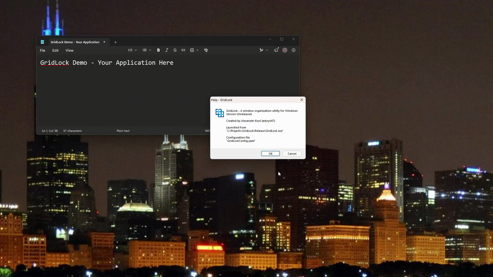

#  **GridLock** - A window organization utility for Windows



## Overview
Have you ever wanted a quick and easy way to organize and arrange your windows in... Windows? - beyond the simple drag-to-edge feature?
Have you ever wanted [Rectangle for macOS](https://rectangleapp.com/)... but on Windows?

Then GridLock is for you!

**GridLock** is a *lightweight* but **powerful** window organization utility.

Key design features are as follows.
 * **Just a single executable to get started.** No installation wizard, or zip files, or messing with registry files... none of that. Just plug & play!
 * **Define all your hotkeys in one text-editable configuration file.** Get as specific or brief as you want to get the hotkey behavior you want.
 * **Utilizes Windows' built-in hotkey engine.** No keylogging whatsoever! GridLock only ever sees the hotkeys you define.
 * **Open-source and built with MinGW.** No need to encumber yourself with MSVC & Windows SDK development environment.

Supported actions include:
- **Tile** – snap to halves, thirds, quarters, or arbitrary grid cells
- **Move / Jump** – reposition by ratio, or jump between displays
- **Increase / Decrease** – grow or shrink a window by a ratio
- **Minimize / Maximize** – standard window state changes
- **Project** - change your display configuration to primary, duplicate, extend, or secondary
- **Revert** - undoes all window state changes applied by GridLock
- **Sequences** – cycle through multiple actions on repeated keybind keypresses
- **Help** – displays the GridLock Help message

## Using & Configuring GridLock

### How to install
Simple. Download and run the GridLock executable.

On first run, GridLock will populate a default `GridLockConfig.yaml` to get you started.

### How to edit your configuration
Open `GridLockConfig.yaml` in the directory you launched GridLock from. You can also use GridLock's notification area context menu to do so.

There, you can edit some basic functionality:
```yaml
#-------------------------------------------------------------------------------
# The minimum window size allowed during a Decrease action, in pixels
# This is done to prevent inadvertently collapsing a window.
minimum:
  width:  100
  height: 100

#-------------------------------------------------------------------------------
# Sets the type of window borders that GridLock operates on.
# Choose between `invisible`, `visible`, or `full`
borders: invisible
```

Followed by all of your hotkey keybinds & actions:
```yaml
#-------------------------------------------------------------------------------
# List of hotkeys #
#-------------------------------------------------------------------------------
hotkeys:
    # Want to be sure you can revert any changes to a window that GridLock makes? Easy!
  - modifiers: [ Alt, Shift ]
    key: 'Backspace'
    action: Revert

    # Just want something that works? Like "TopHalf"?
  - modifiers: [ Alt, Shift ]
    key: ';'
    action: TopHalf

    # GridLock does more than just tiling. Moving, resizing, and more.
  - modifiers: [ Alt, Shift ]
    key: '='
    action: Increase

  - modifiers: [ Alt, Shift ]
    key: ']'
    action: JumpNext

    # Want a super-custom layout? Like an inlayed, right-aligned, two-thirds window?
  - modifiers: [ Alt, Shift ]
    key: 'C'
    action: Tile
    parameters:
      inlay:
        type: DisplayWidth
        ratio: 975 / 1000
      grid: [ 3, 1 ]
      index: 2
      size: [ 2, 1 ]

    # GridLock supports sequences! Repeat hotkey-presses changes the result.
  - modifiers: [ Alt, Shift ]
    key: 'N'
    sequence: [ LeftOrTopThird, MiddleTallOrMiddleWideThird, RightOrBottomThird ]

... and more
```
That is just the tip of the iceberg. Further documentation can be opened by selecting the option from the notification area context menu.

### How to uninstall
Easy-peasy. Close GridLock by clicking its notification area icon and selecting "Quit".

Delete `GridLock.exe`, any documentation `*.html`s, and any configuration `*.yaml`s you have.

Just like that, GridLock is completely eradicated - no funny Local/Roaming/etc. files to leech from your drive space.


## Building & Developing GridLock

### Development Environment
As aforementioned, GridLock was built using Minimalist GNU for Windows's Universal C Runtime (UCRT64). You can install a MinGW development environment from [MSYS2](https://www.msys2.org/). Note that some parts of MSYS2 are already installed with [Git for Windows](https://git-scm.com/install/windows) (Git Bash), but you probably still need MSYS2.

Additionally, GridLock statically embeds the [`libyaml`](https://github.com/yaml/libyaml) C-based YAML library from MSYS2. You can install it with MSYS2's package manager using the command:

`pacman -S mingw-w64-ucrt-x86_64-libyaml`

GridLock was developed using Visual Studio Code, but (of course) feel free to use whichever development environment you like best.

### Makefile commands
Once you have the requisite development environment, GridLock is compiled via `Makefile`.
 * `clean` removes all build artifacts (object files, intermediate resources, executable)
 * `all` builds GridLock for development / console
 * `release` builds GridLock for release / Windows GUI

If you have trouble with how the Makefile tries to create or remove subdirectories, try `make SHELL_TYPE=LINUX` or `make SHELL_TYPE=WINDOWS`.


## License

This software is released under a copyleft license, [GNU Affero General Public License](https://www.gnu.org/licenses/agpl-3.0.en.html) (AGPL).

The AGPL governs the source code only. The GridLock name, logo, and all branding assets are trademarks of Alexander Krysl and are not licensed under the AGPL. Forks that redistribute modified versions must remove official branding and logos.
